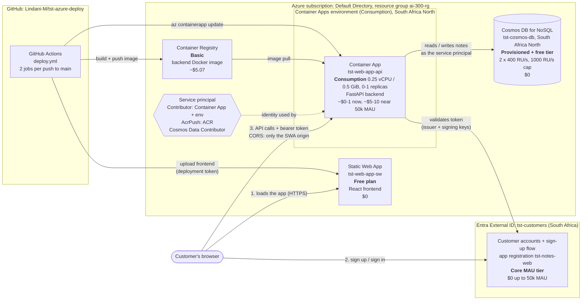

# Architecture and monthly cost

This is the infrastructure as deployed on 8 November 2026, with each service's plan and estimated monthly cost for **up to 50,000 monthly active users (MAU)**.

Prices are pay-as-you-go list prices in **USD**, from the Azure Retail Prices API on 8 November 2026. They're estimates, not a quote. Check the [Azure pricing calculator](https://azure.microsoft.com/pricing/calculator/) or your invoice for real figures.

## Infrastructure

## Monthly cost per service

| Service | Plan / SKU | Region | Now (under 100 daily users) | Near 50k MAU (estimate) | Unit price |
|---|---|---|---|---|---|
| **Static Web App** `tst-web-app-sw` | Free | Global (resource in East US 2) | **$0** | **$0** (see note 1) | Standard plan is $9/month |
| **Container App** `tst-web-app-api` | Consumption, 0.25 vCPU / 0.5 GiB, scale 0–1 | South Africa North | **~$0–1** | **~$5–10** (see note 2) | $0.000024/vCPU-s active, $0.000003/vCPU-s idle, $0.000003/GiB-s, $0.40 per 1M requests. Free each month: 180k vCPU-s, 360k GiB-s, 2M requests |
| **Container Apps environment** | Consumption only | South Africa North | **$0** | **$0** | No charge without Dedicated profiles or private endpoints |
| **Container Registry** | Basic | — | **~$5.07** | **~$5.07** | $0.1666/day |
| **Cosmos DB for NoSQL** `tst-cosmos-db` | Provisioned, **free tier**, 2 × 400 RU/s, account capped at 1000 RU/s | South Africa North | **$0** | **$0** (see note 3) | Beyond the free tier: $0.0117 per 100 RU/s per hour (~$8.54 per extra 100 RU/s per month), $0.365/GB |
| **Entra External ID** `tst-customers` | Core MAU | South Africa | **$0** | **$0** | First 50,000 MAU free, then $0.01625 per MAU. SMS codes would cost $0.03–$0.35 each, but we use email |
| **GitHub Actions** | — | — | **$0** | **$0** | About 3 minutes per deploy. Assumed to stay within GitHub's free minutes (not checked) |
| **Total** | | | **~$5–6 / month** | **~$10–16 / month** | |

### Notes and assumptions

1. **Static Web App Free:**
   - **Bandwidth:** the Free plan has a bandwidth quota (100 GB/month). Near 50k MAU you could get close to it. The app is about 150 KB compressed per first visit, and repeat visits mostly load from the browser cache.
   - **No SLA:** the Free plan has no uptime guarantee.
   - **For real users:** move to **Standard (+$9/month)**. It adds the SLA, and 100 GB of included bandwidth, then $0.20/GB.
2. **Container App near 50k MAU:**
   - **Traffic assumed:** 10 sessions × 20 requests per user per month. That's about 10M requests, with the app active roughly half the time.
   - **Cost:** about 8M billable requests is about $3.20, plus about $4–5 of compute beyond the free allowance.
   - **At that traffic,** raise `--max-replicas` above 1. Consider `--min-replicas 1` (+~$4–6/month) to avoid cold starts.
3. **Cosmos DB near 50k MAU:**
   - **Throughput:** at about 10M requests a month, average throughput is in the tens of RU/s, and peaks should fit within the 800 RU/s provisioned.
   - **Storage:** profiles and notes for 50k users are well under the free 25 GB.
   - **Free tier:** only **one per subscription**, and it's already used here. A second account, for example dev, would cost about **$34/month** for 400 RU/s in South Africa North.
4. **Not priced:**
   - **Logs:** a Log Analytics workspace, if the Container Apps environment sends logs to one, charges for the logs it stores.
   - **Data egress:** outbound data beyond the free amounts.
   - **Rates:** these all use public list prices, with no discounts or currency conversion.

## Where data lives (POPIA)

| Data | Stored | Processed |
|---|---|---|
| Customer accounts (email, password, display name) | Entra External ID tenant, South Africa | Microsoft Entra |
| App profile and notes | Cosmos DB, South Africa North | Container App, South Africa North |
| Frontend files (no personal data) | Static Web App, served globally | Browser |

See [SETUP.md](SETUP.md) for how each service is configured.
